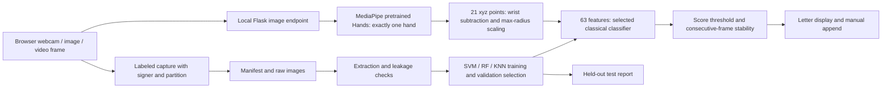

# Architecture

MediaPipe is a pretrained neural landmark detector, not the classifier trained in this lab. A pinned Python release includes its detector weights. Training, image uploads and live/video frames all use independent static-image detection with the same preprocessing. A tracking experiment drifted on repeated saved diagnostic photos, so tracking is not enabled in the app. A lock protects the shared detector; there is no cross-stream tracking state. The diagnostic script can compare static and tracking modes locally without training on debug images.

Coordinates first convert MediaPipe's height-normalized y into image-width units (`y *= height/width`; x and z already use width units). Then they are wrist-relative and divided by maximum 3D landmark radius. This prevents rectangular webcam frames from distorting geometry relative to square training images. Orientation and handedness are retained; this is not rotation invariant. Left-handed/mirrored and extreme poses need represented training data and separate evaluation. No image mirroring is applied by the browser.

No hand and multiple hands produce no letter. The trained model/API baseline cutoff is 0.70. At the user's request the browser starts with a reversible live cutoff of 0.30, adjustable from 0.10 to 0.95. This is a provisional preference, not a validated optimum: lower cutoffs increase coverage and can increase false accepts. Published baseline evaluation remains at 0.70. Video requires four consecutive accepted predictions, reset by invalid frames and cutoff changes. Score filtering is heuristic: it does not guarantee rejection of out-of-vocabulary gestures. Text is manually assembled to avoid claiming temporal language decoding.

Only one request is scheduled per active browser loop. Browser video files are decoded locally; sampled lossless PNG frames are sent to localhost to avoid additional JPEG artifacts relative to training. Static uploads preserve the original file. Stop releases camera tracks and object URLs. The server limits frames to 8 MB and 16 megapixels before downscaling. This is a single-user development app, not an authenticated public service.

The latest interface overlays detected landmarks and shows the closest candidate, fixed required score, and server processing time. An uncertain candidate is diagnostic only: it does not become the accepted letter or enter the text field. The live user confirmed B recognition once but reported repeat failures; webcam reliability remains unvalidated. Manual text assembly is collapsed by default.
